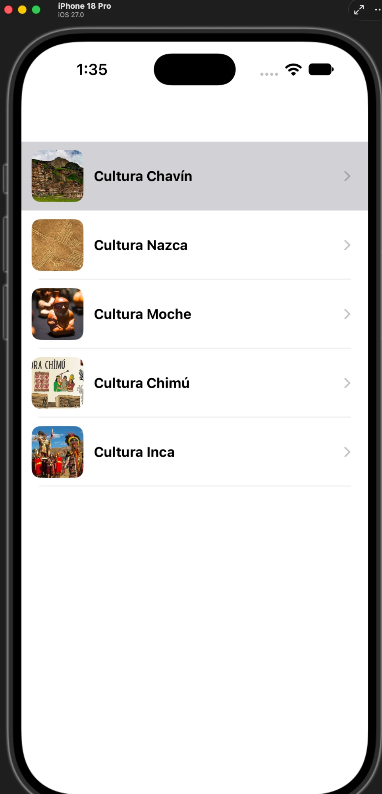
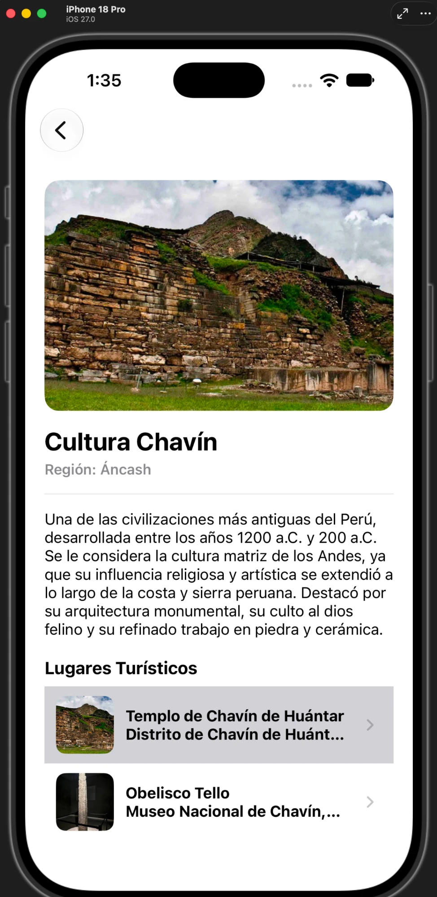
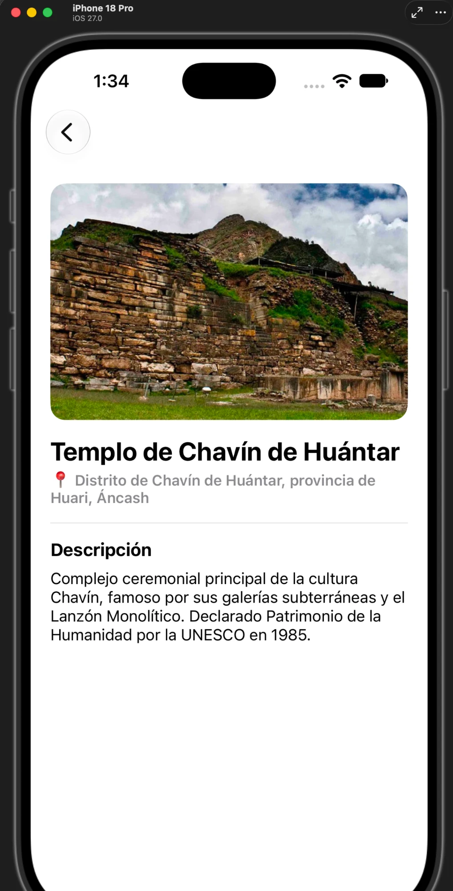
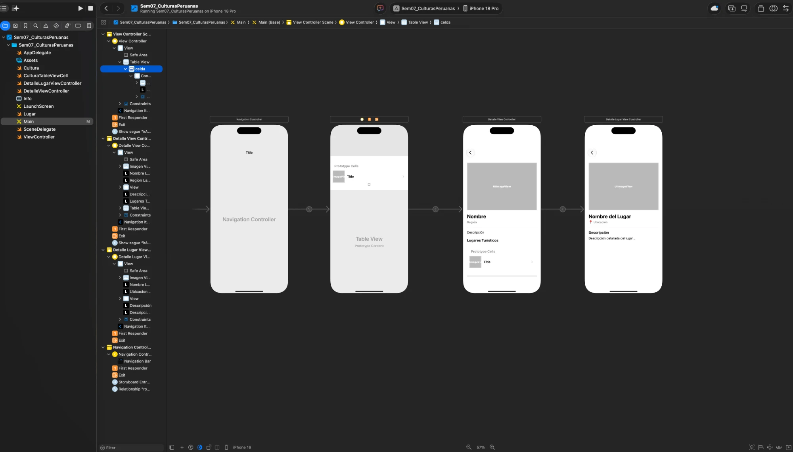

# Sem07 - Culturas Peruanas

Aplicación iOS desarrollada en **UIKit** que permite explorar las principales culturas prehispánicas del Perú. El usuario puede revisar una lista de culturas, ver el detalle histórico de cada una junto a sus lugares turísticos asociados, y consultar la información específica de cada lugar (ubicación, descripción e imagen).

## Caso de uso

Desarrollar una aplicación que permita explorar diferentes culturas peruanas: ver una lista de culturas, seleccionar una de ellas, revisar más detalles (nombre, región, descripción, imagen) y, dentro de ese detalle, explorar los lugares/monumentos que ofrece esa cultura con su propia información.

## Pantallas

### 1. Lista de Culturas (`ViewController`)
- `UITableView` con celda personalizada (`CulturaTableViewCell`) que muestra imagen y nombre de cada cultura.
- Al seleccionar una celda, navega a la pantalla de detalle pasando el objeto `Cultura` seleccionado.

### 2. Detalle de Cultura (`DetalleViewController`)
- Muestra nombre, región, descripción histórica e imagen de la cultura.
- Incluye una sección **"Lugares Turísticos"** con un `UITableView` propio que lista los atractivos de esa cultura (nombre + ubicación).
- Al tocar un lugar, navega a su pantalla de detalle (segue conectado directamente desde la celda prototipo en el Storyboard).

### 3. Detalle de Lugar (`DetalleLugarViewController`)
- Muestra nombre, ubicación (con ícono 📍), descripción detallada e imagen del lugar turístico seleccionado.

## Navegación

Todo el flujo está embebido en un `UINavigationController`, lo que permite navegación estándar de iOS (botón "Atrás" y gesto de swipe desde el borde) entre las tres pantallas:

```
Lista de Culturas → Detalle de Cultura → Detalle de Lugar
```

## Modelo de datos

- **`Cultura`**: `nombre`, `region`, `descripcion`, `imagen`, `lugares: [Lugar]`.
- **`Lugar`**: `nombre`, `ubicacion`, `descripcion`, `imagen`.

Cada una de las 5 culturas incluidas (Chavín, Nazca, Moche, Chimú, Inca) cuenta con 2 o 3 lugares turísticos asociados, cada uno con su propia descripción histórica y ubicación específica (ej. *Cultura Inca → Machu Picchu, Sacsayhuamán, Qorikancha*).

## Estructura del proyecto

```
Sem07_CulturasPeruanas/
├── ViewController.swift              # Pantalla 1: lista de culturas
├── DetalleViewController.swift       # Pantalla 2: detalle de cultura + tabla de lugares
├── DetalleLugarViewController.swift  # Pantalla 3: detalle de lugar
├── Cultura.swift                     # Modelo de datos (cultura)
├── Lugar.swift                       # Modelo de datos (lugar turístico)
├── CulturaTableViewCell.swift        # Celda reutilizable (imagen + nombre)
├── Base.lproj/Main.storyboard        # Flujo visual completo (3 escenas + segues)
└── Assets.xcassets                   # Imágenes de culturas y lugares
```

## Capturas de pantalla

| Lista de Culturas | Detalle de Cultura | Detalle de Lugar |
|---|---|---|
|  |  |  |

### Flujo completo en el Storyboard



## Requisitos

- Xcode 16+
- iOS 17+ (simulador o dispositivo)
- Swift 5
