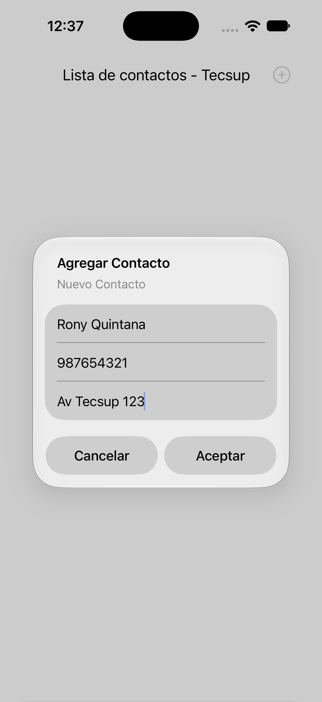
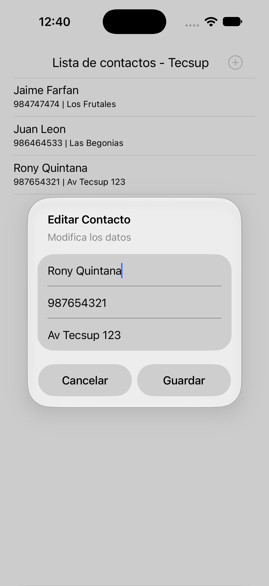
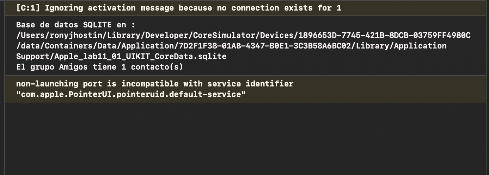
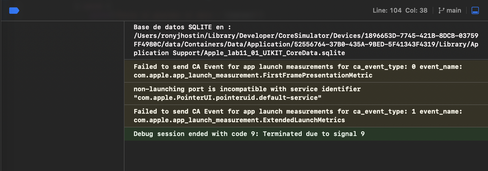

# Lab 11 · Parte 1 — Core Data con UIKit

**Curso:** Programación en Móviles Avanzado · 5 C24
**Docente:** Juan León
**Alumno:** Rony Jhostin Quintana

Agenda de contactos (`Contacto`: nombre, teléfono, dirección) construida con **UIKit + Core Data**, implementando las 4 operaciones del CRUD más un filtro con `predicate` y una relación uno a muchos (`Grupo` ⟶ `Contacto`).

---

## Esquema general

```
┌─────────────┐   dataSource/delegate   ┌──────────────────┐   conexion()   ┌───────────────────────┐
│  TableView   │ ───────────────────▶   │   ViewController   │ ─────────────▶ │ NSManagedObjectContext │
│ (storyboard) │ ◀─────────────────── │  (CRUD + predicate) │ ◀───────────── │   (persistentContainer) │
└─────────────┘    reloadData()       └──────────────────┘    fetch/save   └───────────┬───────────┘
                                                                                         │
                                                                                         ▼
                                                                              Apple_lab11_01_UIKIT_CoreData.sqlite
```

Entidades del modelo (`.xcdatamodeld`):

```
Contacto                    Grupo
├─ nombre: String           ├─ nombre: String
├─ telefono: String         └─ contactos: [Contacto]  (To Many)
├─ direccion: String
└─ grupo: Grupo             (To One, inverse: contactos)
```

---

## CRUD verificado en el simulador

| Operación | Acción | Captura |
|---|---|---|
| **READ** (Paso 6) | Al abrir la app, la tabla carga vacía desde Core Data |  |
| **CREATE** (Paso 7) | Se llena el formulario (Nombre, Teléfono, Dirección)... |  |
| | ...y el contacto aparece guardado en la tabla |  |
| **UPDATE** (Paso 9) | Tocar una fila abre el formulario con los datos precargados |  |
| | Al guardar, el cambio se refleja de inmediato en la tabla |  |
| **DELETE** (Paso 10) | Deslizar la fila revela el botón "Delete" |  |
| | El contacto se borra de la tabla y de SQLite |  |

## Fetch con predicate y relación (Pasos 11-12)

- `buscarContactos(texto:)` — filtra contactos cuyo nombre contiene el texto buscado (`NSPredicate`, `CONTAINS[cd]`).
- `probarRelacion()` — crea un `Grupo` ("Amigos") y lo asigna al primer contacto.
- `contactosDelGrupo(_:)` — recorre la relación inversa (`grupo.nombre == %@`).

| Verificación | Captura |
|---|---|
| Persistencia intacta tras migrar la relación `Grupo.contactos` a **To Many** |  |
| Consola: ruta del `.sqlite` + `"El grupo Amigos tiene 1 contacto(s)"` |  |
| Sesión de depuración en Xcode (consola completa) |  |

---

## Estructura del código

```
Apple_lab11_01_UIKIT_CoreData/
├─ AppDelegate.swift              # persistentContainer (Core Data stack)
├─ ViewController.swift           # CRUD: Read, Create, Update, Delete
├─ ViewController+Relacion.swift  # Fetch con predicate + relación Grupo-Contacto
├─ Base.lproj/Main.storyboard     # Navigation Controller + TableView + botón "+"
└─ Apple_lab11_01_UIKIT_CoreData.xcdatamodeld
   └─ Contacto (nombre, telefono, direccion, grupo→Grupo)
   └─ Grupo (nombre, contactos→[Contacto])
```

## Commits

1. `Lab11 parte 1: CRUD de contactos con Core Data`
2. `Lab11 parte 1: filtro y relación en Core Data`

---

➡️ **Parte 2** (SwiftData con SwiftUI) se trabaja en `../Apple_lab11_02_UIKIT_SwiftData`.
