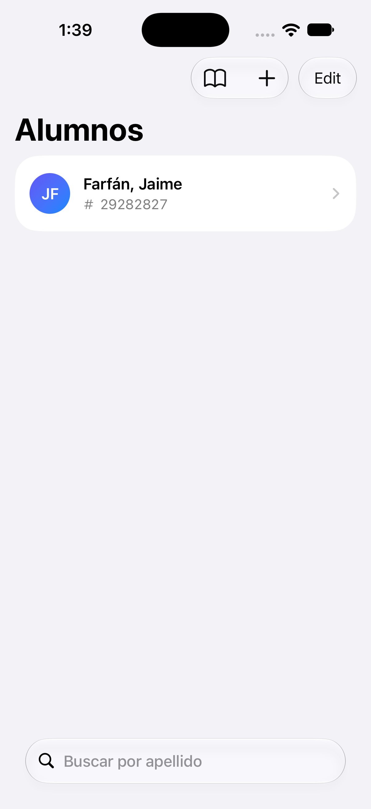
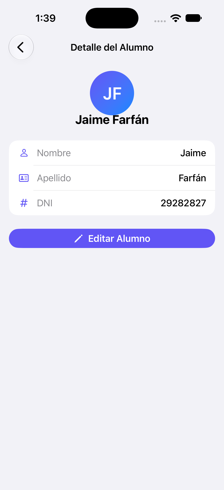
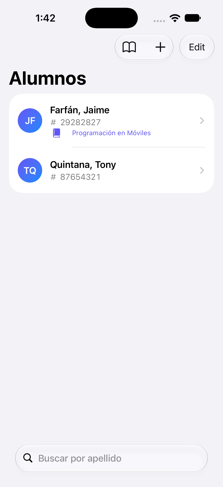
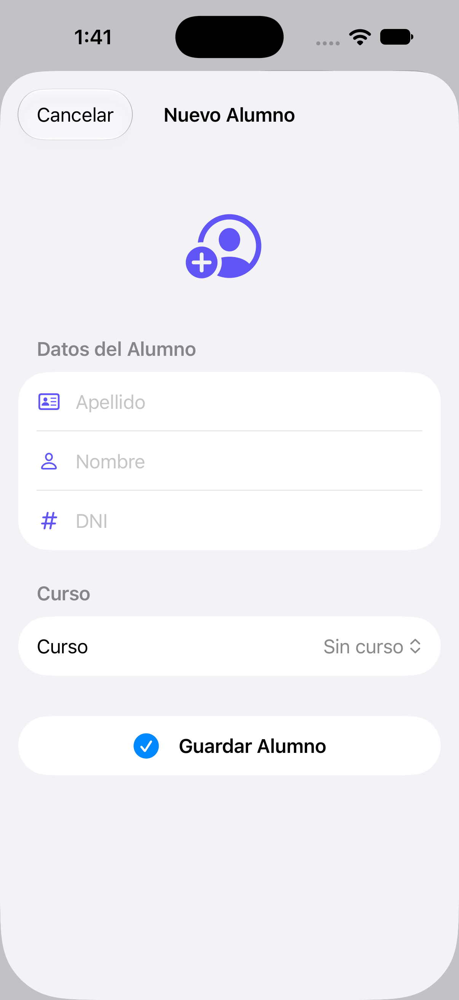
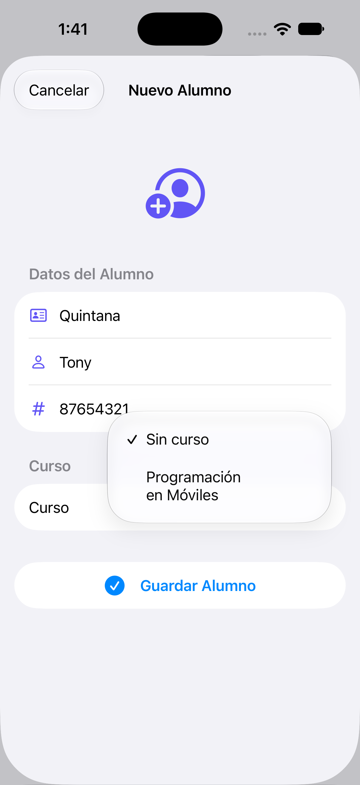
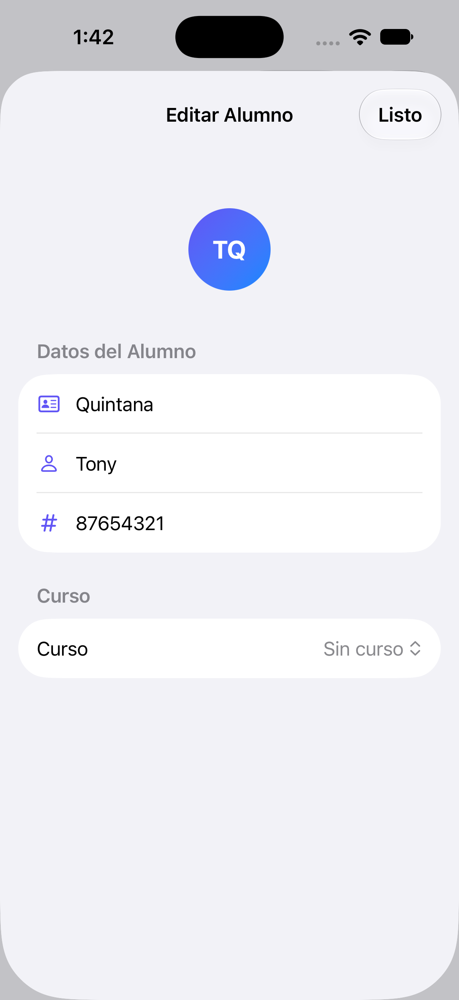
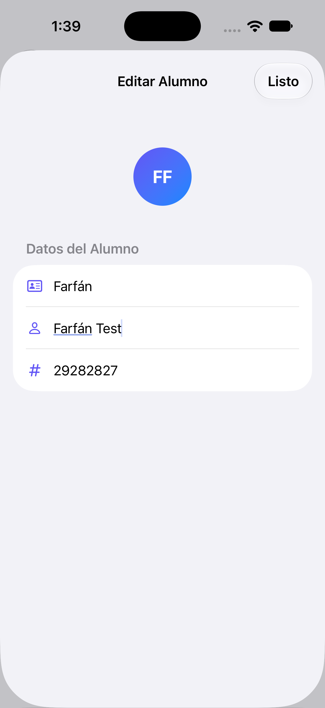
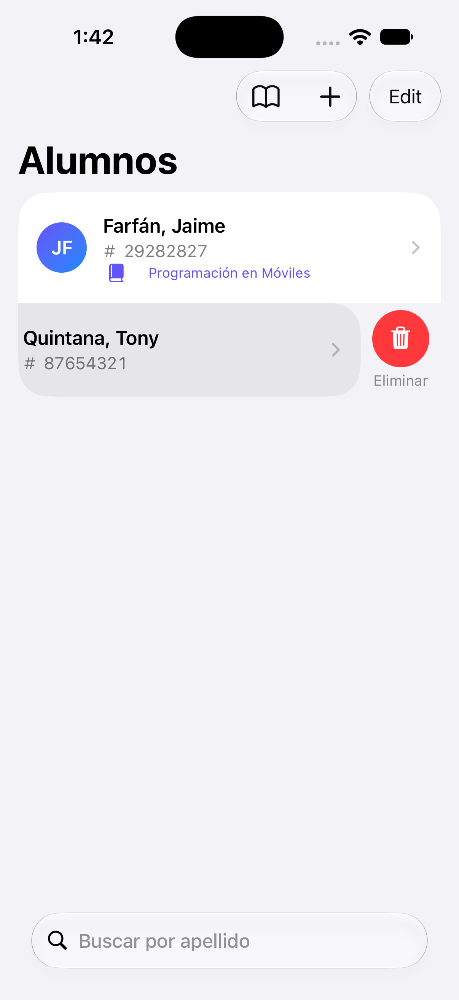
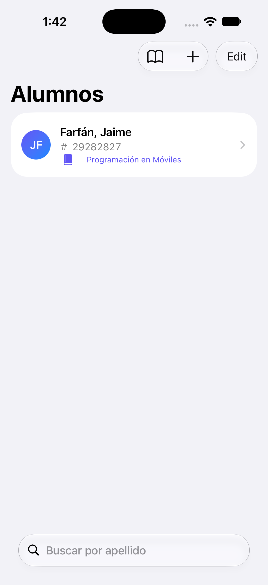
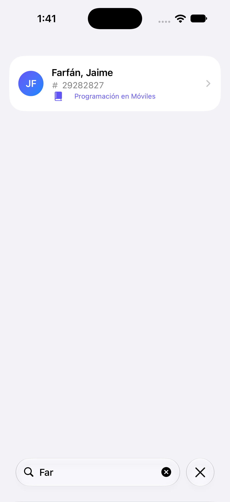

# Lab 11 · Parte 2 — SwiftData con SwiftUI

**Curso:** Programación en Móviles Avanzado · 5 C24
**Docente:** Juan León
**Alumno:** Rony Jhostin Quintana

Agenda de alumnos (`Alumno`: apellido, nombre, DNI) construida con **SwiftUI + SwiftData**, implementando las 4 operaciones del CRUD, búsqueda con `.searchable` y una relación uno a muchos (`Curso` ⟶ `Alumno`). A diferencia de la Parte 1 (Core Data + UIKit), aquí no hay editor de modelo, ni `AppDelegate`, ni `reloadData()`: el modelo es una clase Swift anotada con `@Model` y la vista se actualiza sola con `@Query`.

---

## Esquema general

```
┌───────────────┐   @Query/@Environment   ┌──────────────────────┐   insert/save/delete   ┌──────────────────┐
│  ContentView   │ ───────────────────▶   │  ModelContainerProvider │ ─────────────────────▶ │   ModelContext    │
│ (SwiftUI List) │ ◀───────────────────   │     (singleton)        │ ◀───────────────────── │ (autoactualiza UI) │
└───────────────┘   se redibuja sola      └──────────────────────┘                          └─────────┬─────────┘
                                                                                                        │
                                                                                                        ▼
                                                                                              AlumnosData.sqlite
```

Modelos (`@Model`, clases Swift):

```
Alumno                          Curso
├─ idAlumno: UUID                ├─ nombre: String
├─ apellido: String               └─ alumnos: [Alumno]  (To Many, deleteRule: .nullify)
├─ nombre: String
├─ dni: String
└─ curso: Curso?                 (To One, inverse: alumnos)
```

---

## Vistas del proyecto

| Archivo | Responsabilidad |
|---|---|
| [`Alumno.swift`](Apple_lab11_02_UIKIT_SwiftData/Alumno.swift) | Modelo `@Model` del alumno |
| [`Curso.swift`](Apple_lab11_02_UIKIT_SwiftData/Curso.swift) | Modelo `@Model` del curso (relación 1-a-muchos) |
| [`ModelContainerProvider.swift`](Apple_lab11_02_UIKIT_SwiftData/ModelContainerProvider.swift) | Singleton con el `ModelContainer` (esquema + ruta del `.sqlite`) |
| [`ContentView.swift`](Apple_lab11_02_UIKIT_SwiftData/ContentView.swift) | Lista (READ), búsqueda, swipe para editar/eliminar (UPDATE/DELETE), relación demo |
| [`NuevoAlumnoView.swift`](Apple_lab11_02_UIKIT_SwiftData/NuevoAlumnoView.swift) | Formulario de alta (CREATE) con selector de curso |
| [`EditarAlumnoView.swift`](Apple_lab11_02_UIKIT_SwiftData/EditarAlumnoView.swift) | Formulario de edición con `@Bindable` (UPDATE) |
| [`LabeledTextField.swift`](Apple_lab11_02_UIKIT_SwiftData/LabeledTextField.swift) | Campo de formulario reutilizable con ícono |

### Mejoras de UI sobre la base del laboratorio

- Avatares circulares con iniciales y gradiente índigo/azul.
- Filas tipo tarjeta con DNI y curso (`Label`) en la lista.
- Estados vacíos nativos (`ContentUnavailableView`) para "sin alumnos" y "sin resultados de búsqueda".
- Detalle del alumno rediseñado con tarjeta de datos y botón "Editar Alumno".
- Swipe actions: deslizar a la izquierda edita, deslizar a la derecha elimina (además del modo edición con `EditButton`).

---

## CRUD verificado en el simulador

| Operación | Acción | Captura |
|---|---|---|
| **READ** (Pasos 7-8) | La lista carga desde SwiftData y los datos persisten tras reiniciar la app |  |
| **READ** (detalle) | Detalle del alumno con tarjeta de datos |  |
| **CREATE** (Paso 7) | Se agrega un segundo alumno; la lista se reordena sola por apellido |  |
| **CREATE** + relación | Formulario nuevo con selector de curso |  |
| | Opciones del picker de curso desplegadas |  |
| **UPDATE** (Paso 9) | Swipe izquierdo abre directamente el formulario de edición |  |
| | Formulario de edición con `@Bindable` |  |
| | El avatar se actualiza en vivo mientras se escribe (sin botón "guardar") |  |
| **DELETE** (Paso 7) | Swipe derecho revela el botón "Eliminar" |  |
| | El alumno se borra de la lista y de SQLite |  |

## Búsqueda y relación (Pasos 10-11)

- `.searchable(text: $busqueda, prompt: "Buscar por apellido")` + filtro `localizedCaseInsensitiveContains` sobre el apellido.
- `asignarCursoDemo()` — crea un `Curso` ("Programación en Móviles") y lo asigna a todos los alumnos existentes, demostrando la relación `Alumno.curso ⟷ Curso.alumnos`.

| Verificación | Captura |
|---|---|
| Búsqueda filtra en vivo por apellido |  |
| Estado vacío nativo cuando no hay coincidencias |  |
| Relación Curso→Alumno asignada con el botón "Curso demo" |  |

---

## Estructura del código

```
Apple_lab11_02_UIKIT_SwiftData/
├─ Apple_lab11_02_UIKIT_SwiftDataApp.swift   # @main, conecta ModelContainerProvider.shared.container
├─ ModelContainerProvider.swift              # Esquema [Alumno, Curso] + ruta AlumnosData.sqlite
├─ Alumno.swift                              # @Model: apellido, nombre, dni, curso
├─ Curso.swift                               # @Model: nombre, alumnos (To Many, .nullify)
├─ ContentView.swift                         # READ, DELETE, búsqueda, relación demo, UI
├─ NuevoAlumnoView.swift                     # CREATE
├─ EditarAlumnoView.swift                    # UPDATE (@Bindable)
└─ LabeledTextField.swift                    # Componente reutilizable de formulario
```

## Commits

1. `Lab11 parte 2: proyecto SwiftUI + SwiftData con CRUD de alumnos (pasos 1-7, CREATE/READ/DELETE)`
2. `Lab11 parte 2: editar, buscar y relación Curso-Alumno con SwiftData + mejoras de UI`

---

⬅️ **Parte 1** (Core Data con UIKit) se trabajó en `../Apple_lab11_01_UIKIT_CoreData`.
