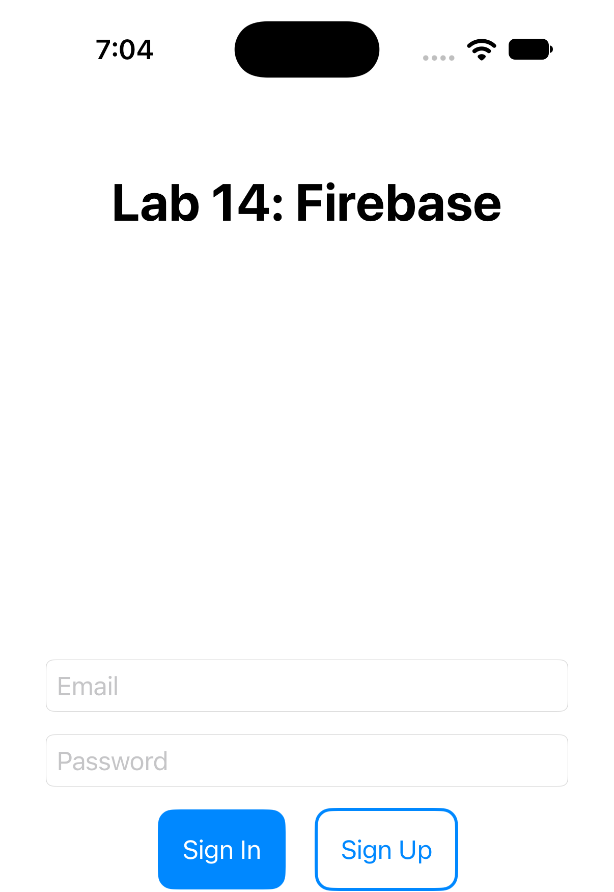
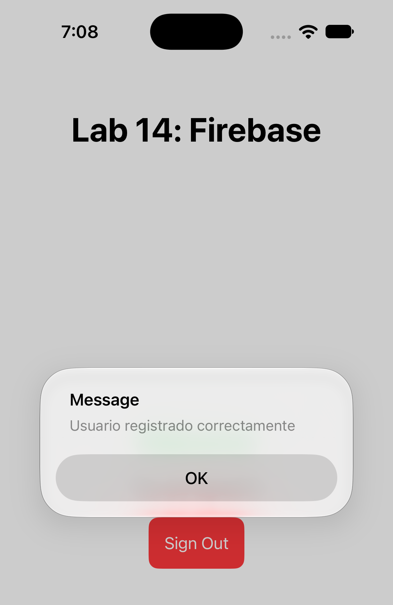
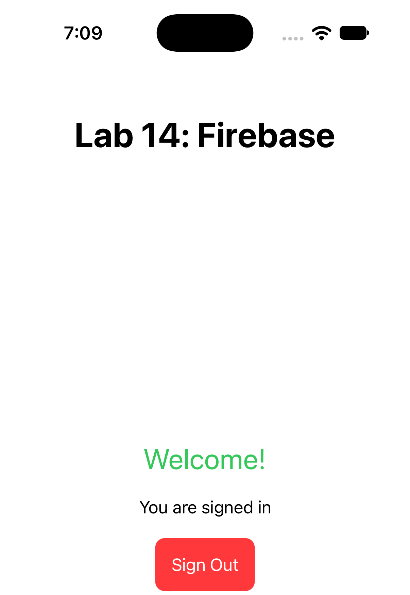
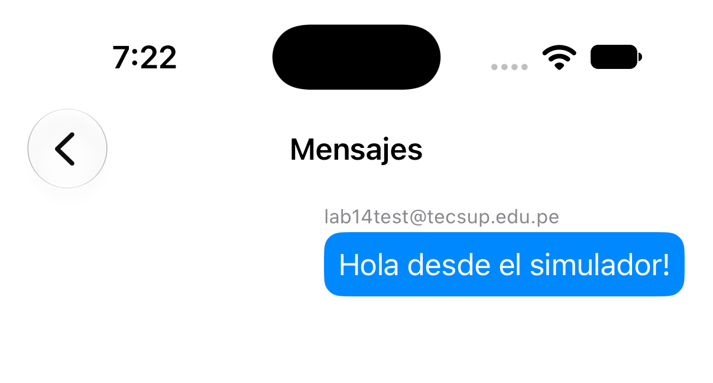
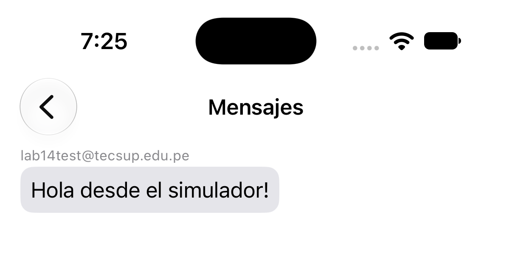
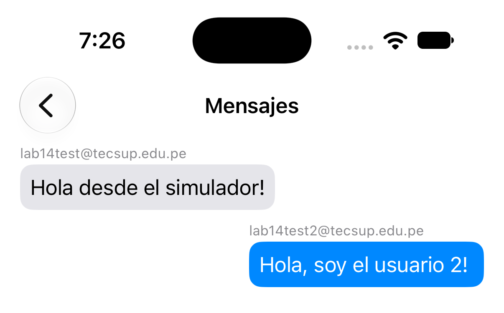

# Lab 14 — Autenticación y Chat en Tiempo Real con Firebase

**Curso:** Programación en Móviles Avanzado · 5 C24
**Docente:** Jaime Gómez – Juan León
**Alumno:** Rony Jhostin Quintana

App en **SwiftUI** que integra **Firebase Authentication** (registro/inicio/cierre de sesión por
correo y contraseña) y **Cloud Firestore** (mensajería en tiempo real entre usuarios autenticados).

---

## Esquema general

```
Actividad 01 — Autenticación
┌──────────────┐   signUp() / signIn() / signOut()   ┌───────────────────────┐
│   AuthView    │ ────────────────────────────────────▶│   FirebaseAuth         │
│  (SwiftUI)    │ ◀──────────────────────────────────── │  (Auth.auth())         │
└──────┬───────┘   addStateDidChangeListener()         └───────────────────────┘
       │ isSignedIn == true
       ▼
Actividad 02 — Mensajería en tiempo real
┌──────────────┐  sendMessage() / observeMessages()   ┌────────────────────────┐
│ MessagesView  │ ────────────────────────────────────▶│   DatabaseService       │
│  (SwiftUI)    │ ◀──────────────────────────────────── │ (Firestore.firestore())│
└──────────────┘   addSnapshotListener (tiempo real)   └───────────┬────────────┘
                                                                     │
                                                                     ▼
                                                     colección "messages" en Cloud Firestore
```

Proyecto Firebase: `App01-Lab14` · Bundle ID: `pe.edu.tecsup.dma.Lab14IntroFirebase`

---

## Actividad 01 — Autenticación con Firebase

`AuthView.swift` expone un formulario de Email/Password con dos acciones (**Sign Up** / **Sign In**)
y, una vez autenticado, un botón **Sign Out**. Un `AuthStateDidChangeListenerHandle` mantiene la UI
sincronizada con el estado real de la sesión en todo momento.

| Paso | Acción | Captura |
|---|---|---|
| 1 | Pantalla de inicio (`AuthView`) sin sesión activa |  |
| 2 | **Sign Up** — registro de un usuario nuevo en Firebase Authentication |  |
| 3 | El listener detecta la sesión y muestra la vista "Welcome!" |  |
| 4 | **Sign Out** + **Sign In** con el mismo usuario ya registrado |  |

---

## Actividad 02 — Mensajería en tiempo real (Cloud Firestore)

`DatabaseService.swift` centraliza el acceso a Firestore (`sendMessage`, `observeMessages`) y
`MessagesView.swift` dibuja la conversación como una lista de burbujas, alineando a la derecha los
mensajes propios y a la izquierda los de otros usuarios (comparando `senderEmail` con el correo de la
sesión activa).

| Paso | Acción | Captura |
|---|---|---|
| 1 | Mensaje enviado y reflejado al instante vía `addSnapshotListener` |  |
| 2 | El mismo mensaje visto desde una segunda cuenta (`lab14test2`) |  |
| 3 | Conversación completa entre dos usuarios, sincronizada en tiempo real |  |

> Las reglas de Firestore se configuraron para permitir lectura/escritura únicamente a usuarios
> autenticados: `allow read, write: if request.auth != null;`

---

## Estructura del código

```
Lab14IntroFirebase/
├─ Lab14IntroFirebaseApp.swift   # @main — FirebaseApp.configure() en init()
├─ ContentView.swift             # punto de entrada -> AuthView
├─ AuthView.swift                # Sign Up / Sign In / Sign Out + listener de sesión
├─ DatabaseService.swift         # Firestore: sendMessage() / observeMessages()
├─ MessagesView.swift            # UI del chat (burbujas propias/ajenas)
├─ GoogleService-Info.plist      # configuración del proyecto Firebase (App01-Lab14)
└─ capturas/                     # evidencias de ejecución en el simulador de iOS
```

## Commits

1. `Lab14: proyecto base en Xcode con Firebase (Auth + Firestore) configurado`
2. `Lab14: Actividad 01 - autenticación con Firebase (Sign Up, Sign In, Sign Out)`
3. `Lab14: Actividad 02 - chat en tiempo real con Cloud Firestore`
4. `Lab14: README y evidencias (capturas + Word) de Auth + Firestore`
